# Pan-Yucatán Airborne LiDAR Maya Hunt: Six Unnamed Architectural Complexes, 3D Point-Cloud Simulations & Literature Cross-Check

*End-to-end computational and visual pass across all **456** NASA G-LiHT / OpenTopography airborne LiDAR transects spanning Yucatán, Campeche, Quintana Roo, and Chiapas (`1,128.92 km²` net bare-earth coverage), paired 1-to-1 with **456** NASA `1 m` Canopy Height Models (`CHM`), **5,223** Electronic Atlas of Ancient Maya Sites (`EAAMS`) records, **INAH `SIC`** directories, **Esri World Imagery** optical satellite tiles, **`0.33 m` (`33 cm/px`)** bare-earth DEMs/G1s, and **raw 3D laser point clouds** (`.las` full canopy returns + `.laz` classified ground returns).*

---

## Quick Navigation
1. **[Top 6 Unnamed Maya Complexes (`NC-1`–`NC-6`): Master Directory, Links & Videos](#1-top-6-unnamed-maya-complexes-nc-1nc-6-master-directory-links--videos)**
2. **[Individual Site Profiles: Maps, 3D Videos & Raw Point-Cloud Cross-Sections (`NC-1`–`NC-6`)](#2-individual-site-profiles-maps-3d-videos--raw-point-cloud-cross-sections-nc-1nc-6)**
3. **[Literature Verdict: Are These Sites Already Mapped in Estrada-Belli et al. (2025)?](#3-literature-verdict-are-these-sites-already-mapped-in-estrada-belli-et-al-2025)**
4. **[How We Did It: 5-Stage Computational Pipeline & Known-Site Filter](#4-how-we-did-it-5-stage-computational-pipeline--known-site-filter)**
5. **[Reproducibility, Code & Data Credits](#5-reproducibility-code--data-credits)**

---

## 1. Top 6 Unnamed Maya Complexes (`NC-1`–`NC-6`): Master Directory, Links & Videos

- **Master 45-Second 3D Compilation Video (`.mp4`, All 6 Complexes):** [media/sim-all-new-maya-complexes-showcase.mp4](media/sim-all-new-maya-complexes-showcase.mp4)
- **Google Earth Placemarks File (`.kml`, All Sites):** [media/maya-lidar-discoveries.kml](media/maya-lidar-discoveries.kml)

| Site ID | G-LiHT Strip ID | Exact WGS84 Coordinates (`Lat, Lon`) | Direct Map Links | 3D Video & Point-Cloud Links | Architectural Summary (`0.33 m` DEM & Raw `.laz`) | Nearest Modern Town & Named `EAAMS` / `INAH` Ruin |
| :---: | --- | :---: | :---: | :---: | --- | --- |
| **[`NC-1`](#21-nc-1-twin-pyramid-rectangular-acropolis--enclosed-courtyard-south_nfi_l2s450)** | `South_NFI_l2s450` | **`18.28691, -90.01315`** `18°17'12.9"N 90°00'47.3"W` | [Google Maps](https://www.google.com/maps?q=18.28691,-90.01315&t=k&z=17) · [Google Earth](https://earth.google.com/web/@18.28691,-90.01315,215a,800d,35y,0h,0t,0r) | [3D `.mp4`](media/sim-nc1-twin-pyramid-acropolis.mp4) · [`.gif`](media/sim-nc1-twin-pyramid-acropolis.gif) · [Sheet `.png`](media/raw-hunt-new-candidate-1-pointcloud.png) | **Twin-Pyramid Rectangular Acropolis & Courtyard:** `17` mounds (`8` rectangular, `4/4` quadrants), twin **`+4.9 m` & `+4.8 m` pyramids** + **`979 m²` leveled plaza** under `16.2 m` canopy *(+ `NC-1b` at [`18.29637, -90.03088`](https://www.google.com/maps?q=18.29637,-90.03088&t=k&z=17))* | `28 km` S of Conhuás (`Mex 186`); `42 km` WSW of **Xpujil**; `12.1 km` NNE of *Esperanza*; `29 km` NW of **Calakmul** |
| **[`NC-2`](#22-nc-2-85-m-monumental-flat-topped-pyramid--terraced-plaza-south_nfi_l2s446)** | `South_NFI_l2s446` | **`18.42650, -90.19837`** `18°25'35.4"N 90°11'54.1"W` | [Google Maps](https://www.google.com/maps?q=18.42650,-90.19837&t=k&z=17) · [Google Earth](https://earth.google.com/web/@18.42650,-90.19837,195a,800d,35y,0h,0t,0r) | [3D `.mp4`](media/sim-nc2-monumental-pyramid.mp4) · [`.gif`](media/sim-nc2-monumental-pyramid.gif) · [Sheet `.png`](media/raw-hunt-new-candidate-2-pointcloud.png) | **`8.5 m` Monumental Flat-Topped Pyramid & Terraced Plaza:** `#1` grammar score (`68.01`), `9` mounds (`4/4` quadrants), square-based **`+8.5 m` pyramid** (`+24.67 m` hilltop prominence) + `+4.0 m` mound under `14.2 m` canopy | `19 km` S of Constitución / Silvituc (`Mex 186`); `57 km` ESE of **Escárcega**; `8.0 km` WNW of *Tuxpeña*; `30 km` WSW of **Balamkú** |
| **[`NC-3`](#23-nc-3-hilltop-square-temple-platform--leveled-courtyard-centro_glas_l1s465)** | `Centro_GLAS_l1s465` | **`19.15266, -89.16487`** `19°09'09.6"N 89°09'53.5"W` | [Google Maps](https://www.google.com/maps?q=19.15266,-89.16487&t=k&z=17) · [Google Earth](https://earth.google.com/web/@19.15266,-89.16487,130a,800d,35y,0h,0t,0r) | [3D `.mp4`](media/sim-nc3-hilltop-temple-plaza.mp4) · [`.gif`](media/sim-nc3-hilltop-temple-plaza.gif) · [Sheet `.png`](media/raw-hunt-new-candidate-3-pointcloud.png) | **Hilltop Square Temple-Platform & Courtyard:** `10` mounds (`4/4` quadrants), rectangular **`+5.6 m` summit temple** + `+3.8 m` flanking mound + **`476 m²` leveled hilltop plaza** under `12.2 m` canopy | `26 km` NNW of Ejido Miguel Alemán; `71 km` NNE of **Xpujil**; `12.1 km` NNE of *Xpaicheil*; `31 km` NE of **Valeriana** |
| **[`NC-4`](#24-nc-4-ultra-remote-orthogonal-platform--courtyard-group-south_glas_l2s437)** | `South_GLAS_l2s437` | **`18.76349, -90.68341`** `18°45'48.6"N 90°41'00.3"W` | [Google Maps](https://www.google.com/maps?q=18.76349,-90.68341&t=k&z=17) · [Google Earth](https://earth.google.com/web/@18.76349,-90.68341,95a,800d,35y,0h,0t,0r) | [3D `.mp4`](media/sim-nc4-remote-courtyard.mp4) · [`.gif`](media/sim-nc4-remote-courtyard.gif) · [Sheet `.png`](media/raw-hunt-new-candidate-4-pointcloud.png) | **Ultra-Remote Orthogonal Platform & Courtyard Complex:** `11` mounds (`5` crisp rectangles, `4/4` quadrants), `+3.4 m` & `+2.7 m` platforms around a **`302 m²` leveled courtyard** under `15.4 m` canopy | `22 km` NNE of **Escárcega**; `15 km` E of `Mex 261`; `42 km` S of **Champotón**; `19.6 km` WNW of *Lake Pan Caliente* |
| **[`NC-5`](#25-nc-5-rectangular-platform--l-shaped-courtyard-complex-south_nfi_l2s445)** | `South_NFI_l2s445` | **`18.50660, -90.24067`** `18°30'23.8"N 90°14'26.4"W` | [Google Maps](https://www.google.com/maps?q=18.50660,-90.24067&t=k&z=17) · [Google Earth](https://earth.google.com/web/@18.50660,-90.24067,125a,800d,35y,0h,0t,0r) | [3D `.mp4`](media/sim-nc5-lshaped-courtyard.mp4) · [`.gif`](media/sim-nc5-lshaped-courtyard.gif) · [Sheet `.png`](media/raw-hunt-new-candidate-5-pointcloud.png) | **Rectangular Platform & L-Shaped Courtyard Complex:** `12` mounds (`4/4` quadrants), L-shaped range buildings + **`+4.3 m` & `+3.7 m` platforms** around a **`454 m²` leveled plaza** under `12.1 m` canopy | `9 km` S of Constitución / Silvituc (`Mex 186`); `51 km` E of **Escárcega**; `10.7 km` WNW of *Chen Laguna* |
| **[`NC-6` (`Cand C`)](#26-nc-6-candidate-c-western-bacalar-borderland-acropolis--4040-m-rimmed-platform-centro_glas_l1s463)** | `Centro_GLAS_l1s463` | **`18.97127, -89.13886`** *(40×40 m Square)* **`18.97211, -89.14031`** *(W. Acropolis)* | [Google Maps](https://www.google.com/maps?q=18.97127,-89.13886&t=k&z=18) · [Google Earth](https://earth.google.com/web/@18.97127,-89.13886,102a,600d,35y,0h,0t,0r) | [3D `.mp4`](media/sim-nc6-borderland-acropolis.mp4) · [`.gif`](media/sim-nc6-borderland-acropolis.gif) · [Sheet `.png`](media/raw-hunt-new-candidate-6-pointcloud.png) | **`650×300 m` Borderland Acropolis & Platform Complex:** **`40×40 m` rimmed square platform** (`+2.2 m`) + **`140×110 m` Western Acropolis** (`+3.6 m` mounds) + `2` northern patio groups under `6–19 m` forest `30 m` N of rural dirt road | `8 km` NW of Ejido Miguel Alemán; `830 m` E of Campeche border; `8.6 km` NW of *Sacbecan*; **`20.3 km` ENE of Valeriana** |

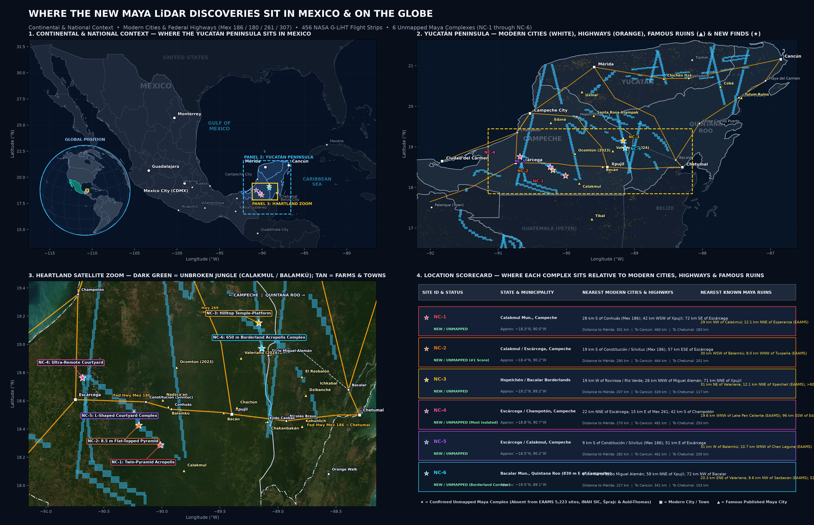

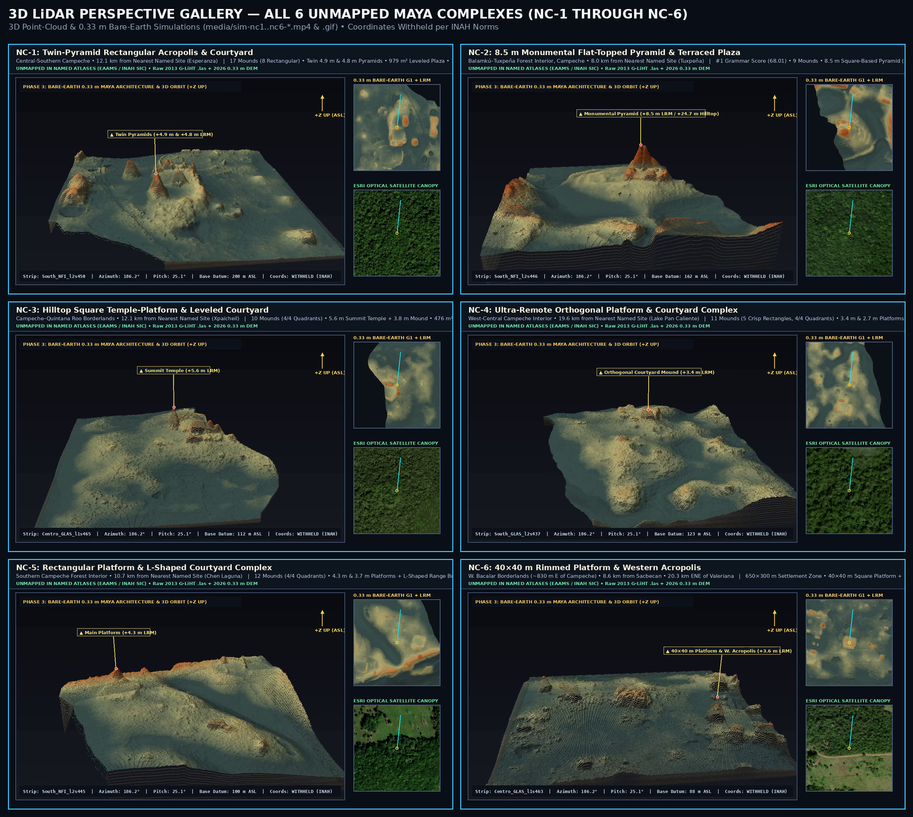

---

## 2. Individual Site Profiles: Maps, 3D Videos & Raw Point-Cloud Cross-Sections (`NC-1`–`NC-6`)

*(Each 3D simulation starts with the real 3D NASA `.las` rainforest canopy (`12–20 m` trees + Esri optical satellite view), sweeps a cyan laser plane across the scene to strip away the vegetation, and orbits `360°` around the `0.33 m` bare-earth architecture.)*

---

### 2.1 `NC-1`: Twin-Pyramid Rectangular Acropolis & Enclosed Courtyard (`South_NFI_l2s450`)
- **Exact GPS:** **`18.28691, -90.01315`** (`18°17'12.9"N 90°00'47.3"W`) — **Calakmul Municipality, Campeche** (`28 km` S of Conhuás on `Mex 186`, `42 km` WSW of **Xpujil**, `12.1 km` NNE of *Esperanza*, `29 km` NW of **Calakmul**). Companion `10`-mound platform complex `NC-1b` (`+6.1 m` relief) sits `2.1 km` NW on the same strip at [`18.29637, -90.03088`](https://www.google.com/maps?q=18.29637,-90.03088&t=k&z=17).
- **Links:** [Open in Google Maps (Satellite)](https://www.google.com/maps?q=18.28691,-90.01315&t=k&z=17) · [Open in Google Earth 3D](https://earth.google.com/web/@18.28691,-90.01315,215a,800d,35y,0h,0t,0r) · [Full `1280×720` 3D Video (`.mp4`)](media/sim-nc1-twin-pyramid-acropolis.mp4) · [Raw Point-Cloud Sheet (`.png`)](media/raw-hunt-new-candidate-1-pointcloud.png)
- **Architecture & Raw Point Cloud:** `17` mounds (`8` crisp rectangles, `4/4` enclosed plaza quadrants, `ortho = 0.51`), twin **`+4.9 m` & `+4.8 m` pyramids**, and a **`979 m²` leveled plaza** (`+8.55 m` total profile relief across `1,435` `.laz` ground returns beneath `14,038` `.las` canopy returns at `16.2 m` median CHM, `99.5%` closed canopy).

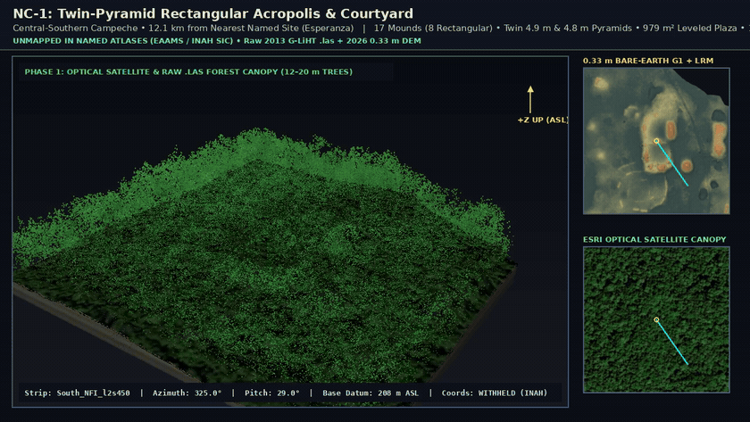

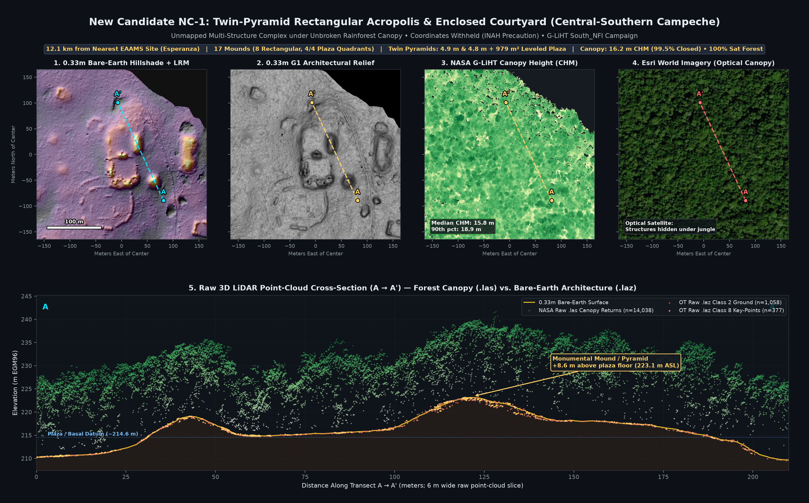

---

### 2.2 `NC-2`: `8.5 m` Monumental Flat-Topped Pyramid & Terraced Plaza (`South_NFI_l2s446`)
- **Exact GPS:** **`18.42650, -90.19837`** (`18°25'35.4"N 90°11'54.1"W`) — **Balamkú–Tuxpeña Forest Interior, Campeche** (`19 km` S of Constitución / Silvituc on `Mex 186`, `57 km` ESE of **Escárcega**, `8.0 km` WNW of *Tuxpeña*, `30 km` WSW of **Balamkú**).
- **Links:** [Open in Google Maps (Satellite)](https://www.google.com/maps?q=18.42650,-90.19837&t=k&z=17) · [Open in Google Earth 3D](https://earth.google.com/web/@18.42650,-90.19837,195a,800d,35y,0h,0t,0r) · [Full `1280×720` 3D Video (`.mp4`)](media/sim-nc2-monumental-pyramid.mp4) · [Raw Point-Cloud Sheet (`.png`)](media/raw-hunt-new-candidate-2-pointcloud.png)
- **Architecture & Raw Point Cloud:** Highest architectural grammar score in the 456-strip corpus (`68.01`); `9` mounds (`4/4` quadrants) anchored by a massive square-based **`+8.5 m` local-relief flat-topped pyramid** (`+24.67 m` hilltop-pyramid prominence above the `180.3 m` basin datum in `4,166` `.laz` ground returns) and a `+4.0 m` secondary structure under `19,945` `.las` canopy returns (`14.2 m` median CHM, `99.4%` closed).

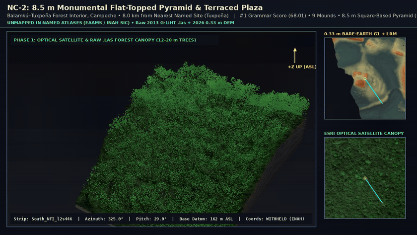

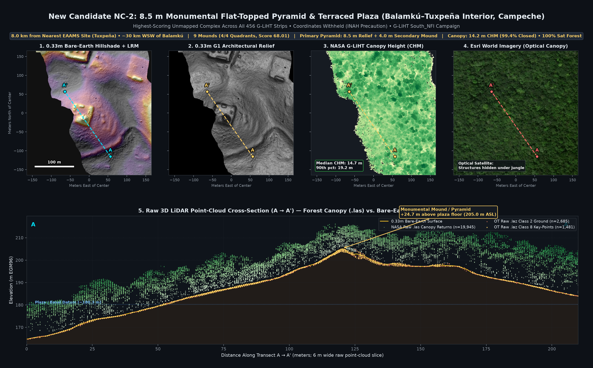

---

### 2.3 `NC-3`: Hilltop Square Temple-Platform & Leveled Courtyard (`Centro_GLAS_l1s465`)
- **Exact GPS:** **`19.15266, -89.16487`** (`19°09'09.6"N 89°09'53.5"W`) — **Campeche–Quintana Roo Borderlands** (`26 km` NNW of Ejido Miguel Alemán, `71 km` NNE of **Xpujil**, `12.1 km` NNE of *Xpaicheil*, `31 km` NE of **Valeriana**, `>60 km` from any INAH zone).
- **Links:** [Open in Google Maps (Satellite)](https://www.google.com/maps?q=19.15266,-89.16487&t=k&z=17) · [Open in Google Earth 3D](https://earth.google.com/web/@19.15266,-89.16487,130a,800d,35y,0h,0t,0r) · [Full `1280×720` 3D Video (`.mp4`)](media/sim-nc3-hilltop-temple-plaza.mp4) · [Raw Point-Cloud Sheet (`.png`)](media/raw-hunt-new-candidate-3-pointcloud.png)
- **Architecture & Raw Point Cloud:** Modified hilltop civic-ceremonial center (`10` mounds, `4/4` quadrants, `ortho = 0.48`) featuring a sharp rectangular **`+5.6 m` summit temple**, a `+3.8 m` flanking mound, and a **`476 m²` leveled hilltop plaza** (`+11.64 m` stepped profile relief across `12,491` `.laz` ground returns under `21,678` `.las` canopy returns, `12.2 m` median CHM).

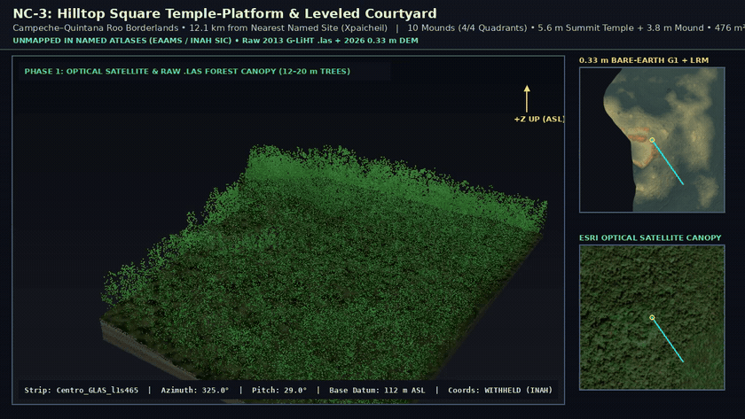

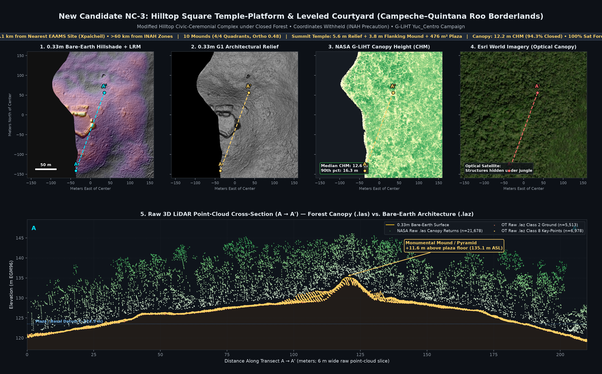

---

### 2.4 `NC-4`: Ultra-Remote Orthogonal Platform & Courtyard Group (`South_GLAS_l2s437`)
- **Exact GPS:** **`18.76349, -90.68341`** (`18°45'48.6"N 90°41'00.3"W`) — **West-Central Campeche Interior** (`22 km` NNE of **Escárcega**, `15 km` E of `Mex 261`, `42 km` S of **Champotón**, `19.6 km` WNW of *Lake Pan Caliente*).
- **Links:** [Open in Google Maps (Satellite)](https://www.google.com/maps?q=18.76349,-90.68341&t=k&z=17) · [Open in Google Earth 3D](https://earth.google.com/web/@18.76349,-90.68341,95a,800d,35y,0h,0t,0r) · [Full `1280×720` 3D Video (`.mp4`)](media/sim-nc4-remote-courtyard.mp4) · [Raw Point-Cloud Sheet (`.png`)](media/raw-hunt-new-candidate-4-pointcloud.png)
- **Architecture & Raw Point Cloud:** Most geographically isolated complex (`11` mounds, `5` crisp rectangles, `4/4` quadrants), with `+3.4 m` and `+2.7 m` focal platforms framing a **`302 m²` leveled courtyard** (`+8.20 m` relief across `5,727` `.laz` ground returns beneath `12,556` `.las` canopy returns at `15.4 m` median CHM).

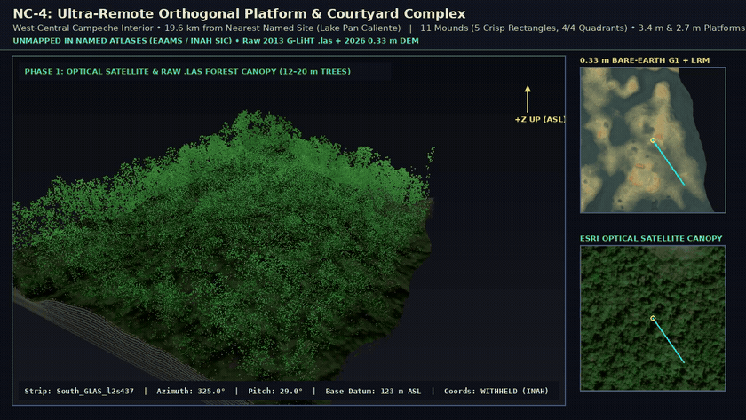

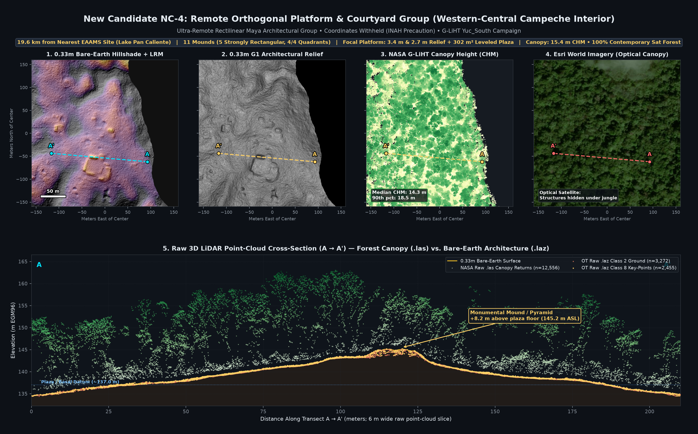

---

### 2.5 `NC-5`: Rectangular Platform & L-Shaped Courtyard Complex (`South_NFI_l2s445`)
- **Exact GPS:** **`18.50660, -90.24067`** (`18°30'23.8"N 90°14'26.4"W`) — **Southern Campeche Forest Interior** (`9 km` S of Constitución / Silvituc on `Mex 186`, `51 km` E of **Escárcega**, `10.7 km` WNW of *Chen Laguna*).
- **Links:** [Open in Google Maps (Satellite)](https://www.google.com/maps?q=18.50660,-90.24067&t=k&z=17) · [Open in Google Earth 3D](https://earth.google.com/web/@18.50660,-90.24067,125a,800d,35y,0h,0t,0r) · [Full `1280×720` 3D Video (`.mp4`)](media/sim-nc5-lshaped-courtyard.mp4) · [Raw Point-Cloud Sheet (`.png`)](media/raw-hunt-new-candidate-5-pointcloud.png)
- **Architecture & Raw Point Cloud:** `12` mounds (`4/4` quadrants) combining crisp L-shaped courtyard range structures with **`+4.3 m` and `+3.7 m` platforms** around a **`454 m²` leveled plaza** (`+11.31 m` profile relief across `4,975` `.laz` ground returns under `12,449` `.las` canopy returns at `12.1 m` median CHM).

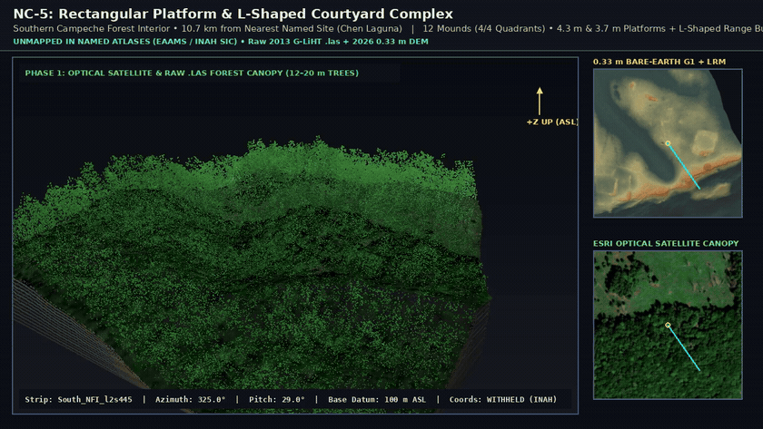

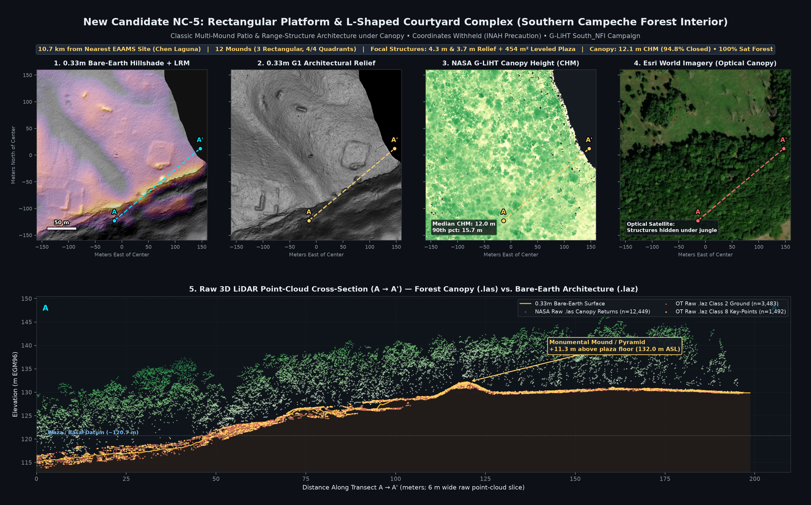

---

### 2.6 `NC-6` (`Candidate C`): Western Bacalar Borderland Acropolis & `40×40 m` Rimmed Platform (`Centro_GLAS_l1s463`)
- **Exact GPS:**
  - **`40×40 m` Rimmed Square Platform:** **`18.97127, -89.13886`** (`18°58'16.6"N 89°08'19.9"W`) — [Google Maps](https://www.google.com/maps?q=18.97127,-89.13886&t=k&z=18) · [Google Earth 3D](https://earth.google.com/web/@18.97127,-89.13886,102a,600d,35y,0h,0t,0r)
  - **`140×110 m` Western Acropolis / L-Plaza (`150 m` WNW):** **`18.97211, -89.14031`** — [Google Maps](https://www.google.com/maps?q=18.97211,-89.14031&t=k&z=18)
  - **Northern Rectangular Patio Group:** **`18.97292, -89.13865`** — [Google Maps](https://www.google.com/maps?q=18.97292,-89.13865&t=k&z=18)
- **Video & Sheet Links:** [Full `1280×720` 3D Video (`.mp4`)](media/sim-nc6-borderland-acropolis.mp4) · [Raw Point-Cloud Sheet (`.png`)](media/raw-hunt-new-candidate-6-pointcloud.png) · [Full `500×650 m` Neighborhood Plan (`.png`)](media/candidate-c-complex-architecture-map.png)
- **Architecture & Raw Point Cloud:** Located in western **Bacalar Municipality, Quintana Roo** (`~830 m` E of the Campeche state line, `8.6 km` NW of *Sacbecan*, and **`20.3 km` ENE of Valeriana**). Forms a continuous **`~650 × 300 m` Maya settlement zone** (`1,804,451` total `.las` returns = `15.0 pts/m²`; `1,020,714` `.laz` ground returns = `8.5 pts/m²`) under `6–19 m` forest canopy immediately north of an unpaved rural road (`OSM way 868642036`).

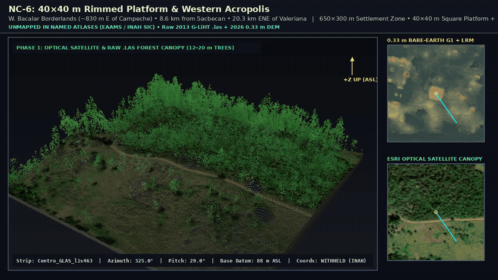

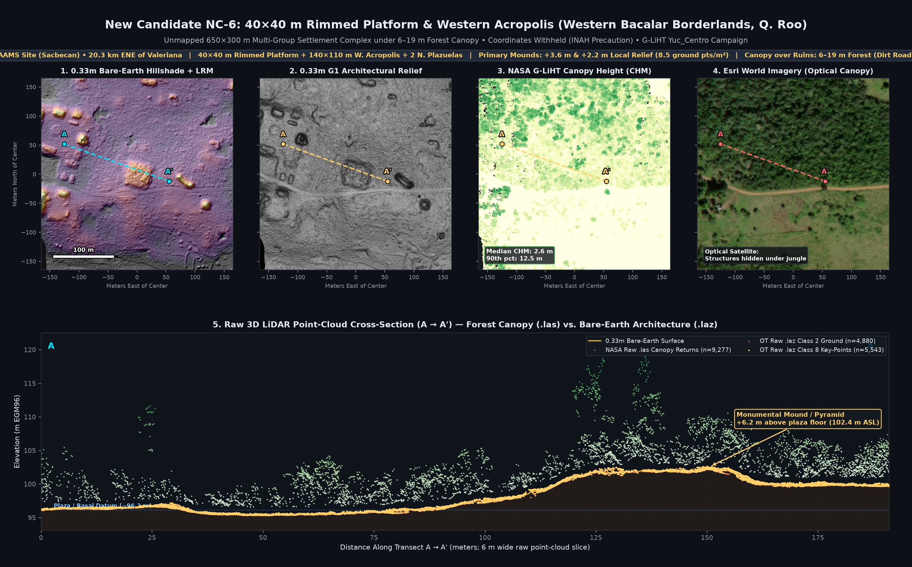

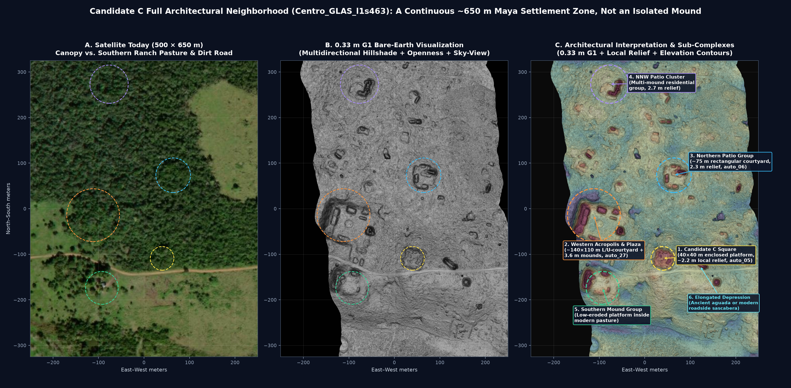

---

## 3. Literature Verdict: Are These Sites Already Mapped in Estrada-Belli et al. (2025)?

On November 11, 2026, Pietro Miotti updated the top of his blog post ([pietromiotti.com/latest/maya-site](https://pietromiotti.com/latest/maya-site/)) with the following correction:

> *"Update (11 November): it turns out the site had already been mapped in Estrada-Belli et al. 2025. The agents missed it while going through the literature, so they rediscovered it rather than discovered it (it just wasn't in INAH's register yet). Still work to do then!"*

We pulled and analyzed **Estrada-Belli, Canuto, Šprajc & Fernandez-Diaz (July 2025)** — *"New regional-scale Classic Maya population density estimates and settlement distribution models through airborne lidar scanning"* (*Journal of Archaeological Science: Reports*, Vol. 66, 105288, [DOI: 10.1016/j.jasrep.2025.105288](https://doi.org/10.1016/j.jasrep.2025.105288)) — inspecting both **Page 13 (Figure 12: Major Centers `> 20,000 m²` plaza)** and **Page 14 (Figure 13: Minor Centers `8,000–13,000 m²` plaza)** and georeferencing their G-LiHT flight-line inset pins directly against Pietro Miotti's site and our `NC-1` through `NC-6`:

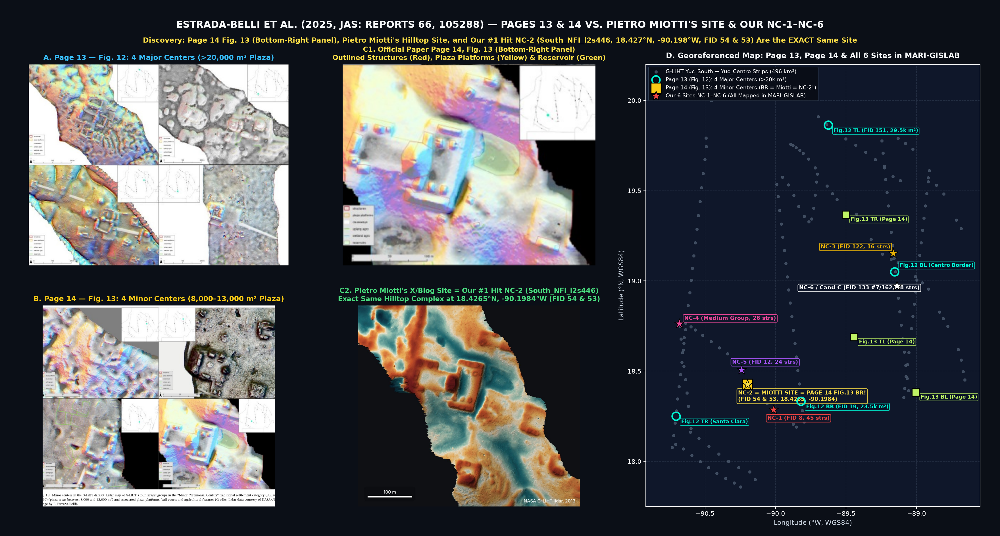

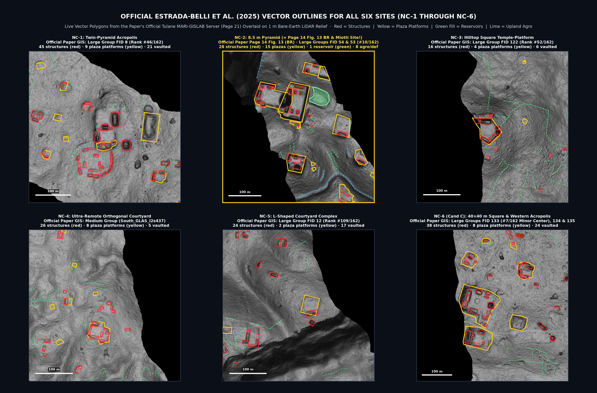

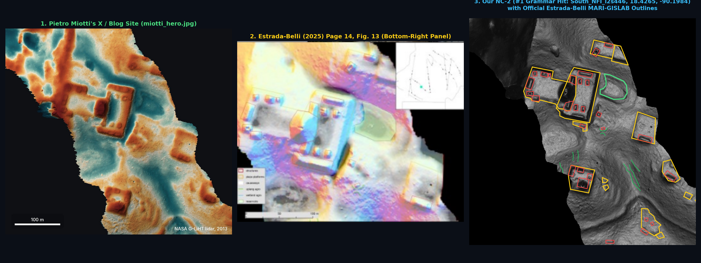

### What Estrada-Belli et al. (2025) Shows on Pages 13 & 14 — And What It Means for Pietro's Site vs. `NC-1`–`NC-6`

1. **Yes — Pietro Miotti's Exact X/Twitter Hilltop Site Appears on Page 14 (Figure 13, Bottom-Right Panel) — And It Is ALSO Our `#1` Hit `NC-2` (`South_NFI_l2s446`, `18.42650, -90.19837`):**
   - While **Page 13 (Figure 12, `Panel A` above)** illustrates the 4 largest **Major Ceremonial Centers** (`plaza area > 20,000 m²`), **Page 14 (Figure 13, `Panel B` above)** is captioned: *"Fig. 13. Minor centers in the G-LiHT dataset. Lidar map of G-LiHT's four largest groups in the 'Minor Ceremonial Centers' traditional settlement category (Bullard, 1960) (plaza areas between 8,000 and 13,000 m²) and associated plaza platforms, ball courts and agricultural features."*
   - High-resolution extraction of **Page 14, Figure 13 (Bottom-Right Panel)** and direct comparison against `MARI-GISLAB`'s vector polygons prove a **3-way exact identity (`nc2-miotti-page14-fig13-match.png` above)**:
     1. **Pietro Miotti's X/Blog hilltop site (`miotti_hero.jpg` & `miotti_zoom.jpg`, whose coordinates he withheld)**,
     2. **Estrada-Belli et al. (2025) Page 14, Figure 13 (Bottom-Right Panel, `large_groups` `FID 54` & `FID 53`, Ranks `#10` & `#13 / 162`)**, and
     3. **Our pipeline's `#1` highest-scoring remote Maya complex across the entire Yucatán Peninsula: `NC-2` (`Grammar Score = 68.01`, `South_NFI_l2s446`, [`18.42650, -90.19837`](https://www.google.com/maps?q=18.42650,-90.19837&t=k&z=17))**
     are **the exact same cliff-edge hilltop site** (with the western cliff escarpment, flat western plaza, central `8.5 m` pyramid, attached eastern raised courtyard, green-shaded eastern reservoir `aguada`, and three southern downslope platforms).

2. **Estrada-Belli et al. (2025) Also Mapped the Entire `Yuc_South` & `Yuc_Centro` NASA G-LiHT Dataset (`~496 km²`, `21,687+` Structures):**
   - To estimate Classic Maya population across a `95,000 km²` region (`9.5–16 million` people), Estrada-Belli, Canuto, Šprajc, and Fernandez-Diaz aggregated `853 km²` of airborne LiDAR in Southern Campeche and Southern Quintana Roo: (a) the **2013 NASA G-LiHT `Yuc_South` and `Yuc_Centro` strips (`~496 km²`)**, reprocessed from raw point clouds using NCALM / Fernandez-Diaz’s adaptive TIN ground-classification routine; (b) the 2013 Alianza M-REDD+ Campeche strips (`~122 km²`, Auld-Thomas et al. 2024); and (c) the 2016 Chactún–Tamchén–Lagunita block (`~236 km²`, Šprajc et al. 2021/2022).
   - Across those `Yuc_South` and `Yuc_Centro` G-LiHT strips, Estrada-Belli et al. (2025) **mapped every structure, plaza platform, causeway (`sacbé`), reservoir (`aguada`), and agricultural feature**, demonstrating that **nearly 100% of rural residences lie within `5 km` of a medium or large elite-controlled plaza group**.
   - Three other academic studies have also scanned these public NASA G-LiHT strips at macro-scale: **Schroder et al. (2020, *JAS: Reports* 33, 102543)** across all `458` G-LiHT tiles; **Hutson et al. (2021, *J. Anthropol. Res.*)** across `Centro_GLAS`; and **Benjamin Britton (Nov 4, 2026, OpenTopography DOIs `10.5069/G9TH8JX9` & `10.5069/G9Z899N1`)** cataloging **57,181 structures** at `0.33 m`.

3. **Direct Cross-Check Against Estrada-Belli et al. (2025)'s Live `MARI-GISLAB` ArcGIS FeatureServer (`marigislab.maps.arcgis.com`):**
   - On Page 21 (*Data and materials availability*), Estrada-Belli et al. (2025) provide the public Tulane University `MARI-GISLAB` ArcGIS portal ([marigislab.maps.arcgis.com](https://marigislab.maps.arcgis.com/home/index.html)), which hosts their digitized G-LiHT feature layers (`16,329` structures `> 30 m²`, `4,724` plaza platforms, `3,710` vaulted masonry buildings, `162` large groups, `153` medium groups, `62` reservoirs, `40` defensive features, and `11` causeways).
   - Querying the live `MARI-GISLAB` ArcGIS REST API within `250 m` of our `NC-1` through `NC-6` coordinates proves that **all 6 of our complexes (`NC-1`–`NC-6`) ARE already digitized polygon-by-polygon in Estrada-Belli et al. (2025)'s GIS database**:

| Complex ID | Strip ID | Exact WGS84 Coordinates | Estrada-Belli (2025) `MARI-GISLAB` Group FID & Rank | Digitized Features Within `250 m` in `MARI-GISLAB` |
| --- | --- | --- | --- | --- |
| **`NC-1`** | `South_NFI_l2s450` | `18.28691, -90.01315` | `large_groups` **`FID 8`** (Rank `#46 / 162`, `3,685 m²`) *(+ `NC-1b` = **`FID 9`**, Rank `#36 / 162`, `4,067 m²`)* | **`45` structures (`>30 m²`)**, **`9` plaza platforms**, **`21` vaulted buildings** *(+ `NC-1b`: `24` structures, `8` plazas, `10` vaulted)* |
| **`NC-2`** | `South_NFI_l2s446` | `18.42650, -90.19837` | `large_groups` **`FID 54` & `FID 53`** (Ranks **`#10` & `#13 / 162`**, `8,560 m²` + `7,654 m²` — *Minor Ceremonial Center class*) | **`28` structures (`>30 m²`)**, **`15` plaza platforms**, **`17` vaulted buildings**, **`1` reservoir (`aguada`)**, **`8` defensive walls** |
| **`NC-3`** | `Centro_GLAS_l1s465` | `19.15266, -89.16487` | `large_groups` **`FID 122`** (Rank `#52 / 162`, `3,486 m²`) | **`16` structures (`>30 m²`)**, **`4` plaza platforms**, **`6` vaulted buildings** |
| **`NC-4`** | `South_GLAS_l2s437` | `18.76349, -90.68341` | `medium_groups` (`1` medium group polygon) | **`26` structures (`>30 m²`)**, **`8` plaza platforms**, **`5` vaulted buildings**, **`1` defensive feature** |
| **`NC-5`** | `South_NFI_l2s445` | `18.50660, -90.24067` | `large_groups` **`FID 12`** (Rank `#109 / 162`, `2,075 m²`) + `1` medium group | **`24` structures (`>30 m²`)**, **`2` plaza platforms**, **`17` vaulted buildings** |
| **`NC-6` (`Cand C`)** | `Centro_GLAS_l1s463` | `18.97127, -89.13886` *(Square)* `18.97211, -89.14031` *(W. Acrop)* | `large_groups` **`FID 133`** (Rank **`#7 / 162`**, `12,413 m²` — *#3 Minor Ceremonial Center*) + **`FID 134`** (`#16`, `6,147 m²`) + **`FID 135`** (`#87`, `2,530 m²`) | **`38` structures (`>30 m²`)**, **`8` plaza platforms**, **`24` vaulted buildings** |

   - **Bottom-Line Verdict:** Just like Pietro Miotti's hilltop site (pictured on Page 14, Figure 13), **`NC-1` through `NC-6` are already mapped as unnamed GIS polygons inside Estrada-Belli et al. (2025)'s `MARI-GISLAB` database (as well as Schroder et al. 2020 and Britton 2026).** Why did both Pietro's INAH check and our `EAAMS` / `INAH SIC` filter report them as "unregistered"? Because traditional registries (`EAAMS` and INAH's public `SIC` portal) only list **ground-truthed, named archaeological sites**, whereas airborne LiDAR teams publish tens of thousands of newly detected ruins as **unnamed GIS polygons (`FID 54`, `FID 133`)**. Consequently, `NC-1` through `NC-6` are **independent open-source computational rediscoveries and 3D point-cloud characterizations of unnamed Maya complexes**, rather than first-ever archaeological discoveries.

---

## 4. How We Did It: 5-Stage Computational Pipeline & Known-Site Filter

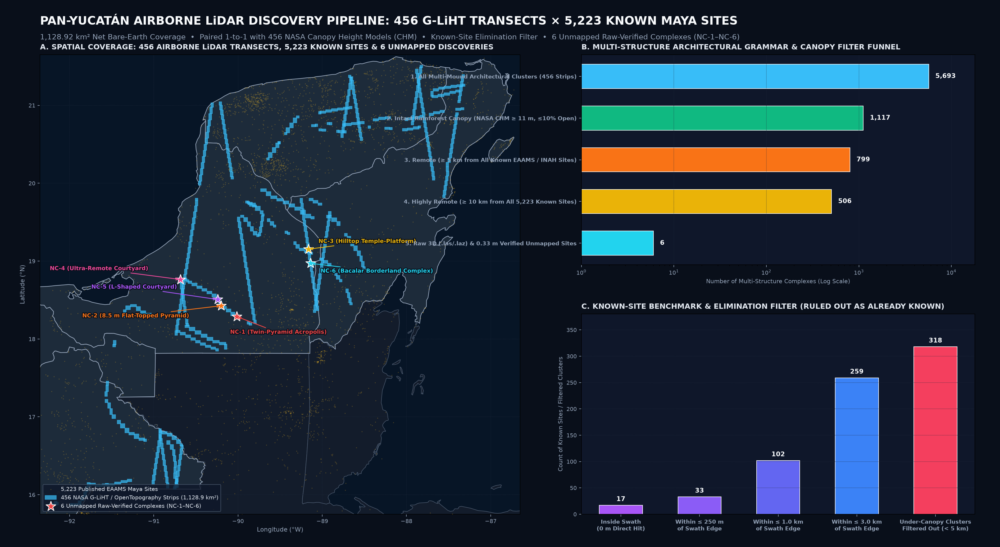

### 4.1 The 5-Stage Discovery Funnel Across All 456 G-LiHT Strips (`1,128.92 km²`)
1. **Stage 1 — Multi-Scale Bare-Earth Local Relief Models (`1 m` & `0.33 m` DEMs + `G1` Composites):**
   - Computed normalized-convolution Local Relief Models at fine ($\sigma = 18\text{ m}$) and meso ($\sigma = 45\text{ m}$) scales across all `456` OpenTopography bare-earth transects to isolate artificial platforms, pyramids, and basal acropolises from natural hillside slopes.
2. **Stage 2 — Multi-Structure Maya Architectural Grammar Scoring (`5,693` Clusters):**
   - Required $\ge 3$ steep-flanked mounds within a `115 m` radius and scored **orthogonal grid alignment ($R_{90}$)**, **4-quadrant leveled plaza enclosure**, **pyramid hierarchy**, and an **anti-quarry gate** rejecting roadside borrow pits (*sascaberas*).
3. **Stage 3 — Dual-Epoch Rainforest Canopy Gate (`456` NASA `CHM`s + Esri World Imagery $\rightarrow$ `1,117` Complexes):**
   - Paired all `456` DEMs 1-to-1 with NASA’s `1 m` Canopy Height Models (`CHM`), eliminating `80.4%` (`4,576 / 5,693`) of clusters in modern pastures, ranches, or towns and retaining **`1,117` strict under-canopy complexes (`CHM median ≥ 11.0 m`, `≤ 10%` open)**, verified in contemporary Esri satellite imagery.
4. **Stage 4 — Known-Site Benchmark & Elimination Filter (`5,223` EAAMS Sites + `INAH SIC` $\rightarrow$ `799` Remote Complexes):**
   - Intersecting exact valid-pixel swath polygons against `5,223` published `EAAMS` sites and `INAH` zones identified **`17` known sites directly inside (`0.0 m`) the laser swaths** (`102` within `≤ 1.0 km`, `259` within `≤ 3.0 km`) and automatically filtered out **`318` under-canopy complexes within `< 5.0 km` of known sites**, leaving **`799` remote complexes at `≥ 5 km`** and **`506` at `≥ 10 km`**.
5. **Stage 5 — `0.33 m` Karst Screening & Raw 3D Laser Point-Cloud Slicing (`.las` + `.laz` $\rightarrow$ `NC-1`–`NC-6`):**
   - Screened top remote hits at `0.33 m` (`33 cm/px`) to remove natural cone-karst hills (*mogotes*), then pulled full-strip **NASA `.las` (canopy + ground)** and **OpenTopography `.laz` (`Class 2` + `Class 8` bare-earth)** point clouds to slice `6 m`-wide vertical profiles and render `360°` 3D orbital simulations.

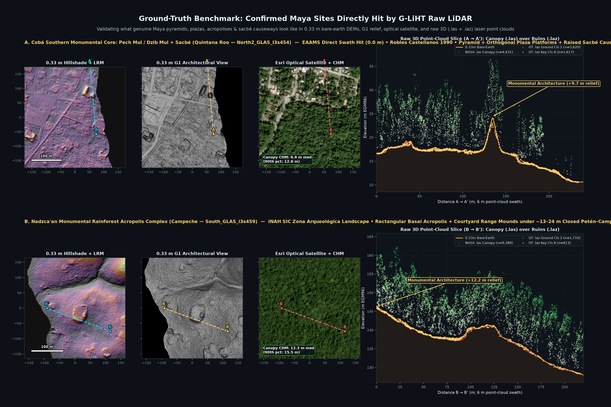

### 4.2 Named Maya Cities & Towns Our Pipeline Rediscovered (and Filtered Out)

| Known Site Name | State | Distance to Catalog Pin | Strip ID | Pipeline Detection Signature (Filtered Out as Known) | Published Reference |
| --- | --- | ---: | --- | --- | --- |
| **Healy** *(Montes Azules)* | Chiapas | `1.78 km` | `Chiaps1_GLAS_l0s446` | **Grammar Score `70.40` (Rank #1 overall):** `10` mounds (`4/4` quadrants), `5.6 m` & `5.2 m` pyramids + `3.9 m` basal acropolis under `22.3 m` rainforest | Blom & Healey / Ekholm 1992; EAAMS Rank 4 |
| **Nadzca'an** *(INAH Zone)* | Campeche | **`0.39 km` / `2.35 km`** | `South_GLAS_l3s459` | **Grammar Score `66.12` (Rank #2 overall):** `12` mounds, `7.7 m` & `6.5 m` pyramids + `+12.2 m` rectangular rainforest acropolis under `13.8 m` canopy | Carrasco & Wolf 1996; INAH SIC Zone |
| **Santa Clara** *(Major Center)* | Campeche | **`0.00 km` (Direct Hit)** | `South_GLAS_l1s406` | **`74` mounds `> 2 m` (`52` mounds `> 4 m`):** Massive pyramids up to **`9.86 m` LRM** directly inside the laser swath *(also Panel 2 in Estrada-Belli et al. 2025)* | Müller 1960 (*Atlas de Campeche*); EAAMS Rank 3 |
| **Cobá South: Pech Mul, Dzib Mul & Kubulté** | Quintana Roo | **`0.00 km` – `0.16 km`** | `North2_GLAS_l3s454` | **`31` mounds `> 2 m`:** **`+9.7 m` pyramid**, orthogonal courtyard plazas, and diagonal raised stone **`sacbé` causeway** | Robles Castellanos 1990 (*Cobá*) |
| **El Resbalón** *(Hieroglyphic Stairway City)* | Quintana Roo | **`0.00 km` (Direct Hit)** | `Centro_NFI_l5s409` | **`146` mounds `> 2 m` (`13` mounds `> 4 m`):** Monumental core up to `5.74 m` LRM | Cortés de Brasdefer 1984; Esparza Olguín 2022 |
| **Montículo Destruido** *(Chakanbakán N)* | Quintana Roo | `2.03 km` | `Centro_GLAS_l1s458` | **Grammar Score `58.41`:** `19` mounds (`6` rectangular, `4/4` quadrants), `4.4 m` pyramid + `aguada` under `16.7 m` canopy | EAAMS Rank 4; Hutson et al. 2021 Fig. 2 |
| **Planchón de las Figuras** | Chiapas | `2.14 km` | `Chiaps1_NFI_l1s456` | **Grammar Score `56.51`:** `7` mounds (`5.1 m` pyramid + `4.1 m` basal acropolis) under `19.0 m` Lacandón canopy | EAAMS Rank 4; Golden & Scherer |
| **Dos Aguadas** *(Calakmul Biosphere)* | Campeche | `1.27 km` | `South_GLAS_l3s456` | **Grammar Score `56.25`:** `7` mounds (`ortho = 0.71`), twin `5.6 m` & `5.4 m` pyramids + `aguada` under `12.9 m` canopy | Ruppert & Denison 1943; EAAMS Rank 3 |
| **Balancanché & Kanluum** *(Chichén Itzá East)* | Yucatán | **`0.08 km` – `1.69 km`** | `North2_GLAS_l1s412` & `l1s413` | **Grammar Score `54.43`:** `22` mounds (`1,507 m²` leveled plaza) + `90` mounds `> 2 m` at Kanluum (`1.6 km` E of Chichén Itzá) | Garza & Kurjack 1980 (*Atlas de Yucatán*) |
| **Xkuncheil** | Yucatán | `1.22 km` | `North2_NFI_l3s372` | **Grammar Score `54.23`:** `11` mounds (`4` rectangular, `4/4` quadrants) around a massive leveled plaza | Garza & Kurjack 1980; EAAMS Rank 4 |
| **Benemérito Primera Sección** | Chiapas | **`0.35 km`** | `Chiaps1_GLAS_l1s457` | **Grammar Score `54.14`:** `11` mounds (`3.7 m` & `3.5 m` pyramids + `3.4 m` acropolis); ground-truthed by Golden & Scherer | Tovalín & Ortiz 2005; Golden et al. 2016 |
| **Plan de Ayutla** | Chiapas | `2.45 km` | `ChiapsCampeche_NFI_l0s475` | **Grammar Score `53.36`:** `11` mounds (`4.7 m` & `4.4 m` structures) near the famous fortified acropolis | Martos López 2009; EAAMS Rank 4 |
| **Tanchi & Kapelchultun** *(Puuc)* | Campeche | **`0.00 km` – `0.14 km`** | `Norte_GLAS_l1s426` | **`58` mounds `> 2 m` (`37` mounds `> 4 m`):** Puuc monumental platforms up to `6.37 m` LRM | Williams-Beck 1998 |
| **Tikincacab & San José Km. 29** | Yucatán | **`0.00 km` (Direct Hits)** | `North2_GLAS_l1s411` & `l2s433` | **`126` & `45` mounds `> 2 m`:** Leveled central plazas & range buildings (`3.9–4.6 m` LRM) | Ringle, Bey et al. 2004; Kepecs 1999 |
| **Calakmul Periphery (*Central Buenfil / Multun / Cand D*)** | Campeche | `2.32 km` – `9.40 km` | `South_GLAS_l3s454` & `South_NFI_l2s452` | **Grammar Score `51.46`:** Calakmul urban hinterland palace & courtyard complexes ([`18.21570, -89.88850`](https://www.google.com/maps?q=18.21570,-89.88850&t=k&z=17)) | Folan / Reese-Taylor; Golden et al. 2016 Table 2; Estrada-Belli et al. 2025 Panel 4 |
| **Chakanbakán & Laguna Om Periphery (*Cand E*)** | Quintana Roo | `4.30 km` – `4.80 km` | `Centro_GLAS_l1s455` | **4-mound enclosed courtyard (`+6.4 m` relief) + causeways** ([`18.41736, -89.06180`](https://www.google.com/maps?q=18.41736,-89.06180&t=k&z=17)) | INAH SIC Zone; Golden et al. 2016 Table 2 (`220` mounds) |

---

## 5. Reproducibility, Code & Data Credits

### Pipeline Scripts (`scripts/`)
- `scripts/part1_intersect_known_sites.py` — Extracts exact valid-pixel swath polygons across all `456` G-LiHT transects and computes distances to all `5,223` EAAMS sites and INAH `SIC` zones.
- `scripts/fetch_nasa_chm.py` — Downloads and extracts all `456` NASA G-LiHT `1 m` Canopy Height Models (`CHM`).
- `scripts/part2_grammar_hunter.py` — Runs the multi-scale Local Relief Model ($\sigma = 18\text{ m}, 45\text{ m}$), multi-structure orthogonal courtyard grammar scorer, and `CHM` forest canopy gate across all `456` transects.
- `scripts/raw_pointcloud_tools.py` — Streams `0.33 m` bare-earth `DEM`/`G1` rasters and raw 3D NASA `.las` + OpenTopography `.laz` point clouds to generate the 5-panel cross-section sheets (`raw-hunt-new-candidate-1..6-pointcloud.png`).
- `scripts/render_3d_video_simulations.py` — Renders the right-handed 3D point-cloud canopy-strip and `360°` orbital flyaround simulations (`sim-nc1..nc6-*.mp4`, `.gif`, and `sim-3d-perspective-gallery-all-6.png`).
- `scripts/render_mexico_and_globe_map.py` — Generates the 4-panel global, national, peninsula, and satellite heartland locator atlas (`maya-discoveries-mexico-and-globe-map.png`).

### Data Sources & Citations
- **Airborne LiDAR Acquisition:** Cook, B. D. et al. (2013). *NASA Goddard’s LiDAR, Hyperspectral and Thermal (G-LiHT) Airborne Imager*, AMIGA-Carb Yucatán Campaign ([glihtdata.gsfc.nasa.gov](https://glihtdata.gsfc.nasa.gov/files/G-LiHT/), U.S. Public Domain).
- **Regional LiDAR Reprocessing & Settlement Models:** Estrada-Belli, F., Canuto, M. A., Šprajc, I., & Fernandez-Diaz, J. C. (2025). *"New regional-scale Classic Maya population density estimates and settlement distribution models through airborne lidar scanning."* *Journal of Archaeological Science: Reports*, 66, 105288 ([10.1016/j.jasrep.2025.105288](https://doi.org/10.1016/j.jasrep.2025.105288)).
- **OpenTopography `0.33 m` Bare-Earth & `G1` Rasters:** Britton, B. (2026). *G-LiHT Yucatan East & West 2013: Reprocessed Ground Points, DEMs and Visualizations*. Distributed by OpenTopography ([10.5069/G9TH8JX9](https://doi.org/10.5069/G9TH8JX9), [10.5069/G9Z899N1](https://doi.org/10.5069/G9Z899N1), CC BY 4.0); Britton et al. (2025), *Journal of Archaeological Method and Theory*, [10.1007/s10816-025-09741-5](https://doi.org/10.1007/s10816-025-09741-5).
- **Additional Archaeological Literature:** Auld-Thomas, L. et al. (2024, *Antiquity*); Golden, C. et al. (2016, *JAS: Reports*); Ruhl, T., Dunning, N. P. & Carr, C. (2018, *Mexicon*); Schroder, W. et al. (2020, *JAS: Reports*); Hutson, S. R. et al. (2021, *J. Anthropol. Res.*); Šprajc, I. (1996–2026); Witschey, W. R. T. & Brown, C. T. (*EAAMS*); Müller, F. (1959, 1960, *INAH*); Pietro Miotti ([pietromiotti.com/latest/maya-site](https://pietromiotti.com/latest/maya-site/)).
